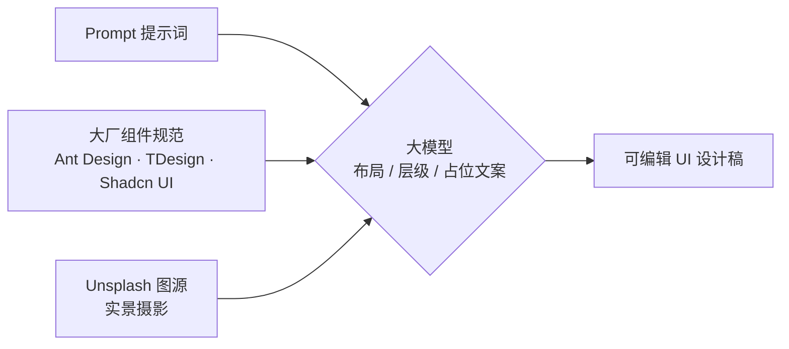

# prompt-to-ui

**用一条提示词，稳定复现高保真 UI 设计稿。**

组件取自大厂开源规范，配图取自 Unsplash，布局与文案交给大模型 —— 把「谁说了算」拆清楚，AI 生成的界面才不会每次都长一个样。

仓库内含一个完整 Demo：**TERRA**，一套英文户外旅行 App 的三屏 UI（引导页 / 首页 / 活动页）。

- 在线预览：`index.html`，或直接启用 GitHub Pages
- 适用人群：产品经理、设计师、独立开发者、想快速验证界面想法的人

---

## 为什么需要这套东西

直接用大模型生成 UI，常见三种失败：

1. **每次都不一样** —— 同一句话，第二遍生成的控件圆角、间距、配色全变了
2. **看着能用，转不成代码** —— 视觉稿里的按钮不是任何组件库的按钮，前端得照着重做
3. **配图不可控** —— 要么全是灰底占位块，要么拉来一堆来源不明的图

根因是把「可变」和「不可变」混在了一起。这个项目的做法是把生成过程拆成三层，**每层指定唯一来源**：



### 三层分工

| 层 | 来源 | 谁说了算 | 能否自由发挥 |
|---|---|---|---|
| 组件（按钮 / 卡片 / 输入框 / 标签） | 大厂开源规范，提前复刻成组件库 | 组件规范 | 不可。只能在给定组件里排列组合 |
| 图片素材 | Unsplash 公开图库 API | 提示词里的关键词 | 半。风格可控，具体是哪张不可控 |
| 排版布局 + 占位文案 | 大模型现场生成 | 大模型 | 可以 |

一句话总结：**大模型是设计师，组件是预制好的积木，图库是弹药库。** 它负责搭积木、找图、写示例文字，但不能自己造积木。

---

## 目录结构

```
prompt-to-ui/
├── index.html              Demo：TERRA 三屏 UI（GitHub Pages 首页）
├── README.md
├── LICENSE                 MIT
├── NOTICE.md               素材来源与版权说明
├── docs/
│   ├── 01-methodology.md   三层架构的完整方法论
│   ├── 02-tool-comparison.md   墨刀 / MasterGo / Figma 横向对比
│   ├── 03-prompt-template.md   可直接复用的提示词模板
│   └── 04-pitfalls.md      避坑清单与上线前检查
├── tokens/
│   ├── terra.css           CSS 变量版本（可直接 import）
│   └── terra.tokens.json   结构化版本（供 Style Dictionary / Figma Tokens 使用）
└── assets/
    └── images.md           Demo 用到的图片清单与授权说明
```

---

## 快速开始

### 本地查看

不需要构建，不需要依赖安装：

```bash
clone 本仓库后直接双击 index.html
```

或起一个静态服务：

```bash
python -m http.server 8000
# 浏览器打开 http://localhost:8000
```

### 发布到 GitHub Pages

1. Push 到 GitHub 仓库
2. `Settings` → `Pages` → `Build and deployment`
3. `Source` 选 `Deploy from a branch`，分支选 `main`，目录选 `/ (root)`
4. 保存，等一两分钟即可通过 `https://<用户名>.github.io/<仓库名>/` 访问

因为 Demo 是单文件 `index.html`（字体走 Google Fonts CDN，图片走 Unsplash CDN），仓库里零构建步骤，Pages 开箱即用。

---

## Demo：TERRA

森林绿主题 + 荧光绿点缀的户外旅行 App，三屏：

| 屏 | 内容 | 用到的规范组件 |
|---|---|---|
| 01 Onboarding | 全屏实景 hero、渐进遮罩、分页指示点、双按钮（filled / ghost） | Button、Carousel dots、Scrim |
| 02 Home | 问候区、搜索框、分类 chips、路线列表卡片、底部标签栏 | Search、Tag、List row、Rate、TabBar |
| 03 Event | 大图头部、悬浮返回 / 分享、日期徽标、数据卡、参与者头像组、行程时间线、底部 CTA 栏 | Badge、Statistic、Avatar.Group、Timeline、Affix bar |

### 设计 Token

色板刻意避开了纯黑与纯白：

| Token | 值 | 用途 |
|---|---|---|
| Forest 950 | `#0B1C14` | 深色屏底色、正文 |
| Forest 800 | `#163527` | 卡片深色、头像底色 |
| Forest 500 | `#2E6B4B` | 次级强调、图标 |
| Fluorescent | `#C8F751` | 主 CTA、标签、徽标、选中态 |
| Paper | `#F1EFE7` | 页面底色 |
| Card | `#FBFBF7` | 卡片与面板底色 |

几何规格沿用 Ant Design：圆角 6 / 10 / 14 / 20 四档，8pt 间距栅格，控件高度 44–50px。

字体：标题 `Fraunces`（带光学尺寸的衬线展示体），正文 `Manrope`。刻意不使用 Inter / Roboto / Open Sans —— 那是 AI 生成界面的默认脸。

完整定义在 [`tokens/terra.css`](tokens/terra.css) 与 [`tokens/terra.tokens.json`](tokens/terra.tokens.json)。

---

## 提示词模板

生成 TERRA 用的就是这段提示词。关键是**把三层都写死**，不给模型留自由发挥的空间：

```
Components
Use component geometry from [Ant Design / TDesign / Shadcn UI].
Do not introduce component styles outside this library.

Screens
Generate 3 mobile screens: onboarding, home, event detail.

Imagery
Use Unsplash landscape photography matched to these keywords:
misty forest, mountain lake, alpine sunset, night ridge.
Keep the visual register consistent. No close-up faces.

Layout & copy
English UI copy. Names, distances, elevation, duration and ratings
are placeholder data and must stay internally consistent.

Constraints
Radius 6/10/14/20, 8pt spacing grid, control height 44-50px.
Palette: forest #0B1C14 / #163527 / #2E6B4B, accent #C8F751,
paper #F1EFE7. No pure black, no pure white.
```

三个可调参数写在 [`docs/03-prompt-template.md`](docs/03-prompt-template.md)，换行业、换主题直接替换即可。

---

## 工具横向对比

同一套架构，不同工具的落地差别很大。核心结论：

- **图库不是差异点** —— 墨刀、MasterGo、Figma 三家都在用 Unsplash，区别只在自动化程度
- **真正的分水岭是组件来源** —— 墨刀给平台的，MasterGo 给大厂规范的（可锁 Ant Design / Element UI），Figma 只要你自己那一套
- **2026 年的新变量是 MCP** —— 三家都在让外部 AI 直接操作画布

| | 墨刀 AI | MasterGo AI | Figma agent + Make |
|---|---|---|---|
| 组件来源 | 平台自有组件库 | 可锁 Ant Design / Element UI 或企业团队库 | 绑定你自己的 library 与 Make kit |
| 图片素材 | AI 自动检索 | 内置 Unsplash，按图层语义填充 | Unsplash 插件为主，需手动 |
| 交付物 | 可点击高保真原型 | 可编辑矢量图层 + D2C Pro 代码 | Make 产出可运行代码，可连后端提 PR |
| 适合谁 | 没有设计系统的团队、产品经理 | 有 Ant Design 底子的企业团队 | 已有成熟 design system 的团队 |

完整矩阵见 [`docs/02-tool-comparison.md`](docs/02-tool-comparison.md)。

---

## 素材与版权

Demo 中的 5 张图片均来自 Unsplash，遵循 [Unsplash License](https://unsplash.com/license)。

需要提醒的是：**Unsplash 免费授权不等于无版权**。照片中出现的人物肖像、商标、艺术品等第三方权利不在授权范围内，原样打包转售也被禁止。正式商业项目上线前请二次核验，具体清单与注意事项见 [`NOTICE.md`](NOTICE.md) 与 [`assets/images.md`](assets/images.md)。

Demo 中的人名、路线名、里程、评分均为大模型生成的占位数据，不代表真实地点或真实评价。

---

## 路线图

- [ ] 深色模式变体
- [ ] 地图页与个人中心，补齐五屏完整流程
- [ ] 导出为 Figma Tokens 可直接导入的 JSON schema
- [ ] 增加 TDesign 与 Shadcn UI 两套换肤 Token
- [ ] 提供 React / Vue 组件落地版本

欢迎 Issue 与 PR，见仓库的 Issue 区。

---

## 许可证

[MIT](LICENSE)。Demo 页面代码可自由使用与修改；其中的图片权益归各自摄影师所有，遵循 Unsplash License，不随代码一并授权。
